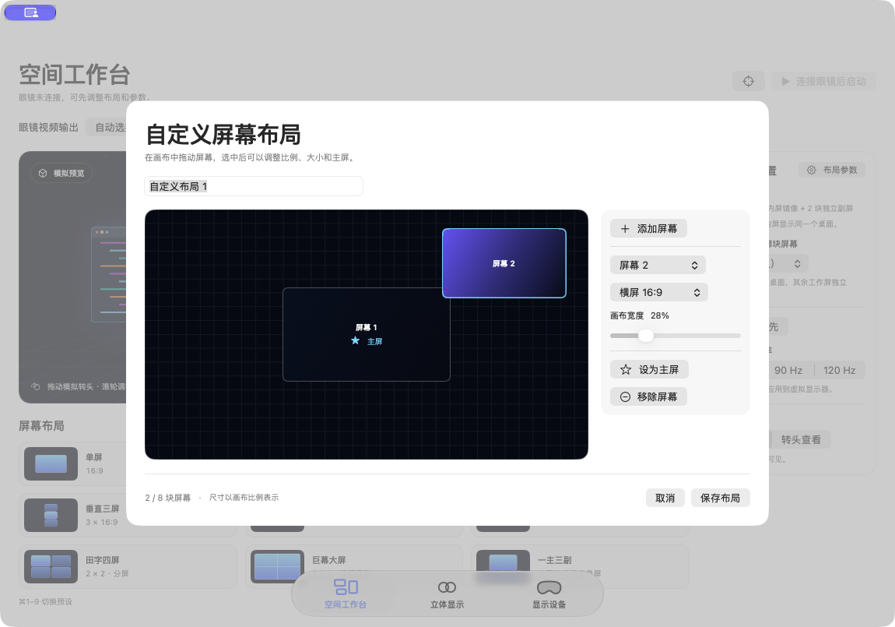
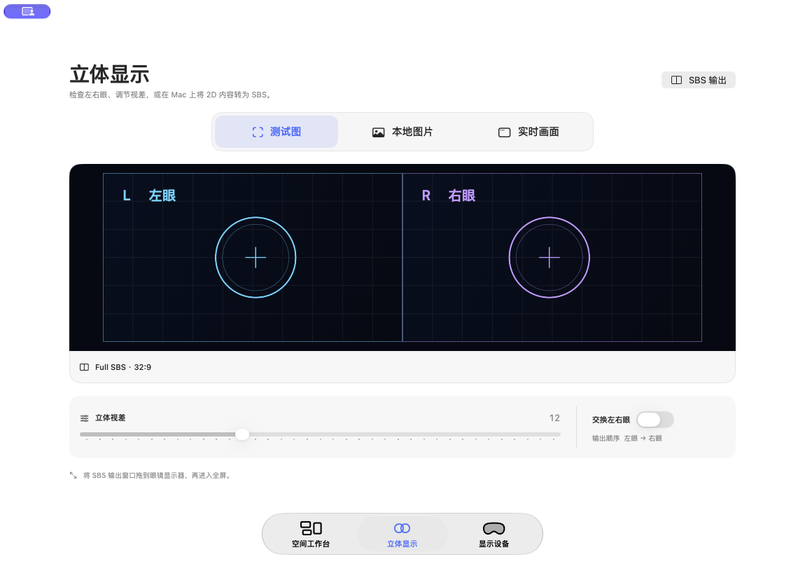

# Prism XR

[English](README.en.md) · [下载 v1.0.0](https://github.com/windycn/prism-xr/releases/tag/v1.0.0)

面向雷鸟 GT 系列 AR 眼镜的 macOS 空间工作台。在任意一块工作屏镜像 Mac 内屏，其余工作屏扩展为彼此独立的桌面。

- **多屏工作台**。九套预设和可拖拽的自定义布局。可指定镜像屏、调整分辨率与 HiDPI，并分别保存刷新率、观看方式和视野。三屏预设的屏幕等大。
- **视角与设备**。支持一览、软件转头查看、滚轮调视野和锁定水平线。GT Max 支持静止校准、视角回正，以及已适配的机身模式控制。
- **显示管理**。眼镜视频输出独立于工作桌面。可将 Mac 内屏亮度降到最低，停止或断开输出时恢复。
- **立体预览**。提供测试图、图片和采集来源的实验性 SBS 预览，镜内立体效果尚待验证。
- **检查更新**。在「Prism XR → 检查更新…」查询 GitHub 最新正式版。发现新版本可打开发布页下载，手动安装。

## 兼容性

需要 Apple Silicon、macOS 27 或更新版本，以及可用的 Mac 内置显示器。本项目的眼镜实机测试专门使用雷鸟 GT Max。开发版已验证该型号的视频输出、姿态采样和多屏采集。V1.0 进行了离线验证。其他 GT 型号、后续雷鸟设备或能被 Mac 识别的外接视频设备，可以手动选择「眼镜视频输出」，以一览或固定视角尝试。通用输出的实机兼容性待验证，头部追踪和机身控制依赖已验证的 GT Max USB 协议。

## 使用

1. 解压发布包，打开 **Prism XR.app**。发布包使用临时签名，尚未经过 Apple 公证，也可从源码自行构建。
2. 用支持视频的 USB-C 连接眼镜。如未自动识别，在工作台选择对应的外接输出。
3. 选布局并点击「开始空间桌面」。首次使用需要允许当前应用录制屏幕。更新临时签名构建后，macOS 可能要求重新关联权限。
4. GT Max 启用软件追踪后，平视静止片刻完成校准。需要时使用「视角回正」。

## 构建与验证

使用 Xcode 27 工具链打开 `Prism XR.xcodeproj` 或执行 `bash build.sh`。执行 `bash Tests/run.sh --gpu` 运行离线回归和 GPU 像素回读。实机与离线验证见 [验证记录](VALIDATION.md)。

虚拟显示器使用 macOS 私有接口。第三方组件附有 [DeskPad MIT 声明](Resources/DeskPad-MIT.txt) 和 [Depth Anything V2 Apache 2.0 许可](Resources/Apache-2.0.txt)。Prism XR 是独立项目。

## 更多界面

