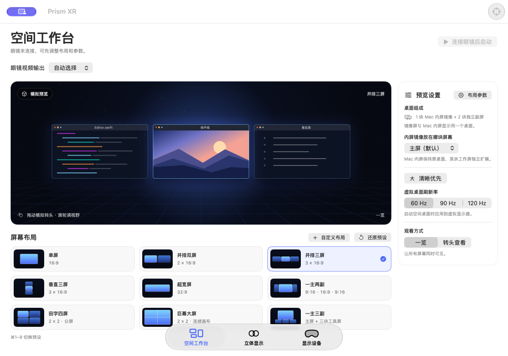

# Prism XR

[简体中文](README.zh-CN.md) · [Download v1.0.1](https://github.com/windycn/prism-xr/releases/latest)

A native macOS spatial workspace for RayNeo GT-series AR glasses. Mirror the Mac’s built-in display in one position and extend it with independent desktops you can arrange around you.

- **Spatial desktops.** Nine presets and custom drag-to-arrange layouts. Choose which screen mirrors the Mac, where each desktop goes and how large it appears. Resolution, HiDPI, refresh rate and viewing settings are saved per layout.
- **Viewing controls.** Overview and head-turn viewing, a field-of-view slider and horizon lock. On GT Max, software head tracking supports recentering and stationary calibration. Use the device page for supported hardware modes and diagnostics.
- **Display controls.** The glasses output is separate from the workspace desktop count. The optional dimming control remembers and restores built-in display brightness.
- **Stereo preview.** Experimental depth-based SBS preview for images or selected capture sources. Optical compatibility has not been verified.
- **Updates.** Choose **检查更新…** in the **Prism XR** menu. The app checks the latest stable GitHub release and opens the release page when a newer version is available. Installation is manual.

## Compatibility

Apple Silicon, macOS 27 or later, and an active Mac built-in display. All physical glasses testing for Prism XR was performed specifically with RayNeo GT Max on earlier development builds. Version 1.0 was checked offline. For other GT models, future RayNeo glasses or compatible external video displays, select the output under **眼镜视频输出**. Generic output uses a fixed view or overview. Head tracking and hardware mode controls depend on the verified GT Max USB protocol. Video compatibility with other models is unverified.

## Getting started

1. Extract the release ZIP and open **Prism XR.app**. The build is ad hoc signed and has not been Apple notarized. You can also build from source.
2. Connect the glasses over a video-capable USB-C connection. If automatic detection is unavailable, choose the intended external display.
3. Select a layout and click **开始空间桌面**. Grant macOS Screen & System Audio Recording permission to the running app when requested. An updated ad hoc build may need its permission associated again.
4. On GT Max, hold still during calibration and use **视角回正** as needed.

## Build and verification

With the Xcode 27 toolchain, open `Prism XR.xcodeproj` or run `bash build.sh`. Run `bash Tests/run.sh --gpu` for offline regressions and Metal pixel readback. [Validation notes](VALIDATION.md) record hardware and offline evidence. The user interface is currently in Simplified Chinese.

Virtual displays use private macOS APIs. The [DeskPad MIT notice](Resources/DeskPad-MIT.txt) and [Depth Anything V2 Apache 2.0 license](Resources/Apache-2.0.txt) accompany their respective components. Prism XR is an independent project.

